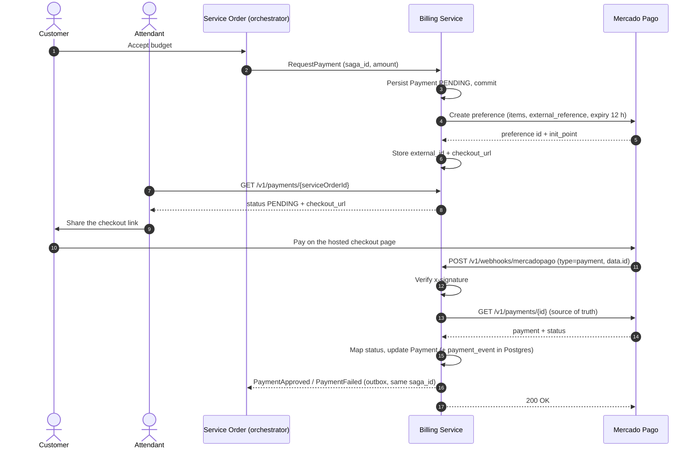

# RFC 0001 — Mercado Pago integration (Checkout Pro)

- Status: Implemented in the Mercado Pago provider change; decisions in [§10](#10-decisions-and-remaining-questions), the final design is ADR 0003. The items under "Still open" are not closed by that change.
- Date: 2026-11-02 (revised after the sandbox proof of concept and aligned with `billing-service` `develop` @ `00f9ed3`, PR #1 merged)
- Author: Giusier F.
- Related: billing-service PR #1, merged (`PaymentProvider` port, ADR 0002 "Billing without an external payment gateway"), service-order-service PR #1 (orchestrated saga), project decisions D11, R1, R2 and R10 (`docs/decisions.md` of `auto-repair-shop`), `mercadopago-poc` (local proof of concept, results in its README)

## Summary

The challenge requires the Billing service to integrate with Mercado Pago. The bootstrap of the Billing service deliberately left the gateway out of scope (its ADR 0002) and ships a `PaymentProvider` port with a single `InternalProvider` (modes `auto-approve`, `auto-reject`, `manual`). This RFC proposes the **Mercado Pago provider** that plugs into that port, using **Checkout Pro** (hosted checkout), and describes how it fits the orchestrated saga already implemented by the service-order service.

A standalone proof of concept ran the whole flow against the real Mercado Pago sandbox (checkout, approved/rejected/pending payments, reconciliation, expiry, refund, mocked webhooks). Its results replace most of the earlier assumptions and are tagged below. **Nothing here changes what is already implemented**: the saga, the message contracts (`testdata/contracts/*`), the payment statuses, the REST routes and the `manual`, `auto-approve` and `auto-reject` modes stay as they are (project decision D11: plug Mercado Pago in without changing the saga). The provider is added next to them. §1 lists the constraints that come from the code, and §11 says where each change plugs in. The RFC also records the team's answers to the open questions. Once the remaining items are resolved, the decision is recorded in an ADR, which also supersedes the "without gateway" part of ADR 0002.

Each claim is tagged **[doc]** (read in the official docs), **[pr]** (read in the bootstrap PRs), **[poc]** (observed in the sandbox proof of concept) or **[verify]** (not confirmed yet).

## 1. Context: what already exists [pr]

- **Saga:** orchestrated by the service-order service. It sends commands to Billing (`GenerateBudget`, `CancelBudget`, `RequestPayment`, `RefundPayment`) and waits for replies (`BudgetGenerated`, `PaymentApproved`, `PaymentFailed`, `PaymentRefunded`). The orchestrator, not Billing, changes the OS status.
- **Messaging:** SNS/SQS, with an outbox and relay on the producer side and a deduplicating consumer (`processed_message`) on the consumer side. Every message is an envelope with `message_id`, `saga_id`, `service_order_id`, `request_id`.
- **Payment model:** statuses `PENDING`, `APPROVED`, `REJECTED`, `CANCELLED`, `REFUNDED`; `payment.saga_id` is stored from `RequestPayment` so later events carry the saga. One open payment per service order (partial unique index).
- **Provider port:** `PaymentProvider { Charge(ctx, Payment) (Outcome, error); Refund(ctx, Payment) error }` with outcomes `APPROVED`, `REJECTED`, `PENDING`. **`Charge` currently runs inside the database transaction of the command**, which is fine for the internal provider and not for a remote call (ADR 0002 says so).
- **REST today:** `GET /v1/budgets/:serviceOrderId` (attendant, mechanic, admin, and the customer who owns it), `GET /v1/payments/:serviceOrderId` (attendant and admin only: project decision R10, the customer does not see the payment), and manual `POST /v1/payments/:id/confirm|reject` (attendant, admin; 204, 409, 404). The payment response has `id`, `budget_id`, `service_order_id`, `amount`, `status`, `provider`, `created_at`; no checkout URL yet.
- **What each command does today** (README of the service): `RequestPayment` creates a `PENDING` payment and charges it, publishing `PaymentApproved` or `PaymentFailed` (nothing while pending); `RefundPayment` moves `PENDING → CANCELLED` and `APPROVED → REFUNDED`, publishing `PaymentRefunded` only for the second; invalid or duplicated requests are logged and discarded.
- **Contracts are fixed:** `PaymentFailed.reason` is `PAYMENT_REJECTED` and the order service maps any `PaymentFailed` to `REJECTED` / `PAYMENT_REJECTED`; the timeout reasons (`SAGA_TIMEOUT`) belong to the orchestrator. The fixtures in `testdata/contracts/` are compared with the real payloads by `contract_test.go`, so a new message or reason needs the contract updated in every service. [pr]
- **Configuration:** `PAYMENT_MODE` is read in `bootstrap.go` (`payment.ParseMode`) and set per overlay: `lab` and `stg` use `auto-approve`, `prd` uses `manual`. `stg` and `prd` read their secrets from the Secrets Manager secret `auto-repair-shop-<env>/billing` through an ExternalSecret that extracts all keys into `billing-service-secrets`. [pr]
- **Data and migrations:** one migration so far (`000001`: `budget`, `budget_item`, `payment`, `processed_message`, `outbox`); `payment.provider` is a `VARCHAR(30)` holding `internal`; status checks and the partial unique index `uq_payment_open_per_so` (`PENDING`, `APPROVED`) are already in place. [pr]
- **Order status model (R2):** `accept` moves the order to `IN_PROGRESS` at once; payment and execution happen afterwards without changing the status. [pr]
- **Entry point:** the former monolith is now the gateway (PR #344); its `config/routes.yaml` routes `/v1/budgets*` and `/v1/payments*` to Billing and blocks `/internal/*`. There is no route for a webhook yet. Its end-to-end suite runs the services with `PAYMENT_MODE=manual`. [pr]
- **Working agreement:** feature branches go to `develop` by pull request (ADR 0001); the next ADR number in Billing is 0003. [pr]

## 2. Chosen flow

**Checkout Pro**: on `RequestPayment`, Billing creates a *preference*, stores its checkout URL on the payment, and leaves the payment `PENDING`. The attendant reads the URL and hands it to the customer, who pays on a Mercado Pago-hosted page. Mercado Pago notifies Billing through a webhook (or the reconciler finds the payment), and Billing replies to the saga with `PaymentApproved` or `PaymentFailed`. No card data ever reaches our services. [doc, poc]



## 3. Credentials and environments

- Create a Mercado Pago application in the developer panel ("Suas integrações"). The seller **test account** created with it owns the test credentials; the access token is the long `APP_USR-...` value (about 75 characters). The 44-character `APP_USR-<uuid>` value is the public key and is rejected with `403`. [poc]
- To pay in the sandbox, buyer and seller must both be **test users of the same country** (Brazil); a mixed pair shows "Uma das partes ... é de teste". Log in as the test buyer in an incognito window first. [poc, doc]
- Access token → `MERCADOPAGO_ACCESS_TOKEN`; webhook secret → `MERCADOPAGO_WEBHOOK_SECRET` (generated in *Webhooks > Configurar notificações*, renewable). [doc]
- Public webhook URL → `MERCADOPAGO_NOTIFICATION_URL`.
- Both secrets live only in env vars / Kubernetes Secrets (never in git, logs or fixtures).
- `PAYMENT_MODE` gains one value for the real gateway (e.g. `mercadopago`, added to `payment.ParseMode`); `manual`, `auto-approve` and `auto-reject` stay exactly as they are, because the local ecosystem, the gateway's end-to-end suite and the `lab`/`stg`/`prd` overlays depend on them. The overlays only switch to `mercadopago` where the credentials exist (§10).

## 4. Changes to the existing port

`Charge` cannot hold a database transaction while calling Mercado Pago, and a pending checkout needs data the current `Outcome` cannot carry. Proposed shape (names indicative):

```go
type ChargeResult struct {
    Outcome     Outcome // APPROVED | REJECTED | PENDING
    ExternalID  string  // preference id
    CheckoutURL string  // init_point
}

type PaymentProvider interface {
    Charge(ctx, Payment) (ChargeResult, error)
    Refund(ctx, Payment) error
    // used by the webhook and reconciliation
    Get(ctx, externalID string) (GatewayPayment, error)
    Find(ctx, externalReference string) ([]GatewayPayment, error)
    ExpireCheckout(ctx, preferenceID string) error
}
```

`RequestPayment` becomes **two transactions** for the Mercado Pago provider, as ADR 0002 already anticipates:

1. Tx 1: validate, persist `Payment` as `PENDING`, commit.
2. Call `Charge` (no transaction held).
3. Tx 2: store `external_id` and `checkout_url`.

If the process dies between 1 and 3, the payment stays `PENDING` without a checkout; the **reconciliation job** (§8) detects `PENDING` payments with no `external_id` and retries the creation using an idempotency key derived from `payment.id`. The internal provider keeps its single-transaction behaviour.

Schema additions on `payment` (new migration `000002`; `000001` is never edited): `external_id` (nullable, unique when set), `gateway_payment_id`, `checkout_url`, `expires_at`; `provider` holds `mercadopago` for these payments. Mercado Pago structs never leave the provider package.

The existing `InternalProvider` keeps its current `Charge`/`Refund` behaviour. The new shape is introduced without changing its outcomes (for example through a second interface that only the Mercado Pago provider implements), so the internal modes, `fakeProvider` in the service tests and the contract tests keep passing unchanged.

## 5. Creating the checkout (preference)

- Endpoint `POST /checkout/preferences`, `Authorization: Bearer <access token>`. [poc]
- Fields we send, all accepted and stored as sent [poc]:
  - `items[]`: `title`, `quantity`, `unit_price`, `currency_id: "BRL"`. `unit_price` is a decimal number in reais: `10` charged R$ 10,00. The SDK models it as `float64`, so the cents-to-float conversion happens only inside the provider. Items come from the budget lines; the total must equal the payment amount.
  - `external_reference` = our `payment.id`.
  - `notification_url` (HTTPS, public; localhost not allowed; takes priority over the panel URL) [doc]; omitted when empty.
  - `expires: true` and `expiration_date_to` (now + 12 h, UTC).
  - No `back_urls` / `auto_return`: there is no frontend.
- Response: preference `id` (store it), `init_point` and `sandbox_init_point`. **Use `init_point` only** (decision 16): it opened and took payments with test users; `sandbox_init_point` (`sandbox.mercadopago.com.br`) showed a generic "Ops, ocorreu um erro". [poc]
- **Installments add interest for the buyer.** With 2x selected the checkout added R$ 0,96 to a R$ 10 item (total R$ 10,96). The payment then carries `transaction_amount` (10, our price) and `transaction_details.total_paid_amount` (10,96). Compare and settle against `transaction_amount` (decision 14). Installments stay allowed (decision 17). [poc]
- One preference per payment. The checkout URL is returned by `GET /v1/payments/:serviceOrderId`, restricted to attendant and admin (project decision R10: the customer sees the budget and the OS status, not the payment); the attendant gives the link to the customer.

**Client: official Go SDK** (`github.com/mercadopago/sdk-go`), wrapped by the provider. Confirmed in the POC [poc]: `config.New(token, config.WithHTTPClient(requester))` accepts a fake `requester.Requester`, so provider tests run with no network and can assert the exact requests; the SDK sends `X-Idempotency-Key` when set with `requestoptions.WithIdempotencyKey`; endpoints are `POST /checkout/preferences`, `PUT /checkout/preferences/{id}`, `GET /v1/payments/{id}`, `GET /v1/payments/search`, `PUT /v1/payments/{id}` (cancel) and `POST /v1/payments/{id}/refunds`.

## 6. Webhook

- Mercado Pago POSTs JSON: `type` = `payment`, `action` (`payment.created` / `payment.updated`), `data.id`; the query string also carries `data.id` and `type`. [doc]
- Must answer **200/201 within 22 s**; retries at 0, 15 min, 30 min, 6 h, 48 h, 96 h ×3 (8 attempts). [doc]
- **Test credential payments may not send notifications** — the panel's webhook simulator is the documented way; not tested here. [doc, verify]
- `POST /v1/webhooks/mercadopago` is public (no JWT middleware) and authenticated only by the signature. It needs a **new route in the gateway's `config/routes.yaml`** (no token validation there, so nothing else changes). [pr]
- The body is read with a size limit (64 KB), and a missing webhook secret rejects every call (fail closed). [poc]

### Exposure

- `notification_url` is built from `MERCADOPAGO_NOTIFICATION_URL`; nothing in the code assumes a gateway.
- Local: an HTTPS tunnel (e.g. ngrok), or no tunnel at all by mocking the webhook (below). Mercado Pago rejects non-HTTPS and local addresses. [doc]
- Lab deployment without a domain: the reconciliation job (§8) re-fetches `PENDING` payments, so payments still settle without webhooks. The real webhook is tested once the service is in the AWS Lab.

### Signature validation

Header `x-signature: ts=<ms>,v1=<hex>`; also uses `x-request-id` and the query `data.id`. The SDK provides `webhook.ValidateSignature(xSignature, xRequestID, dataID, secret, opts...)`, which builds the manifest `id:<data.id>;request-id:<x-request-id>;ts:<ts>;` (empty pairs omitted), computes HMAC-SHA256 in hex, compares in constant time and, with `WithTolerance`, rejects timestamps too far from now. Use it instead of re-implementing the algorithm. [poc]

A signature built locally with the same manifest was accepted, and a wrong secret (`SignatureMismatch`) or an old timestamp (`TimestampOutOfTolerance`) was rejected. [poc] Payment ids are numeric, so the open question about lowercasing alphanumeric ids does not apply.

### Processing steps

1. Verify signature → 401 + `payment.webhook_invalid_signature` if invalid.
2. Ignore types other than `payment` (log and return 200).
3. `Get(data.id)` — never trust the body.
4. Find our `Payment` by `external_reference`; unknown → log + 200.
5. Map status; if unchanged → no-op (`payment.webhook_duplicate`).
6. In one transaction: apply the transition (validated by `Payment.Transition`), insert the `payment_event` row, and enqueue the saga event in the outbox with the payment's stored `saga_id` (`PaymentApproved` or `PaymentFailed`).
7. Respond 200. Transient failures (DB/gateway, including a payment id Mercado Pago does not know) → 5xx so Mercado Pago retries.

### Mocking the webhook

A notification can be sent by hand with a locally signed header; the service then fetches the payment from the real sandbox, as it would for a real notification. Eight scenarios ran against real sandbox payments with the expected results: wrong secret and stale timestamp → 401; other notification type → 200 ignored; rejected payment → `PENDING → REJECTED`; the same notification again → duplicate; in-process payment → stays `PENDING`; refunded payment on an approved order → `APPROVED → REFUNDED`; unknown payment id → 500. [poc]

## 7. Status mapping

| Mercado Pago `status` | Domain | Saga effect |
|---|---|---|
| `pending`, `in_process`, `authorized` | `PENDING` | none |
| `approved` | `APPROVED` | `PaymentApproved` |
| `rejected` | `REJECTED` | `PaymentFailed` (reason `PAYMENT_REJECTED`) |
| `cancelled` | `CANCELLED` | `PaymentFailed` (reason `PAYMENT_REJECTED`, the only reason in the contract) |
| `refunded`, `charged_back` | `REFUNDED` | `PaymentRefunded` |
| `in_mediation` and anything unknown | log + ignore (do not guess) | none |

Observed in the sandbox, 1x credit card [poc]:

| Cardholder name | `status` / `status_detail` | Result |
|---|---|---|
| `APRO` | `approved` / `accredited` | `APPROVED` |
| `OTHE` | `rejected` / `cc_rejected_other_reason` | `REJECTED` |
| `CONT` | `in_process` / `pending_contingency` | stays `PENDING` (the page says the answer comes "in a few hours") |
| after a seller refund | `refunded` / `refunded`, `transaction_amount_refunded` = amount, one entry in `refunds` | `REFUNDED` |

Two consequences:

- **A rejection does not end the checkout.** The rejection screen offers "Escolher outro meio", so the customer can pay again on the same preference, creating a second payment for the same `external_reference`. If `rejected` fails the order, the preference must be expired at that moment (§9), otherwise a later approval lands on a closed order.
- **An `in_process` payment stays `PENDING`** while the checkout is valid, because it can still be approved or rejected. At the 12 h expiry it is cancelled at Mercado Pago and treated as rejected (decision 13).

Timestamps such as `date_approved` come with a `-04:00` offset; parse them, do not assume UTC. [poc]

The docs advise handling `topic_merchant_order_wh` notifications and processing every notification of a purchase when several payments are possible. [doc] The rule for several approved payments is **parked** (see §10).

## 8. Idempotency, resilience, reconciliation

- Webhooks can repeat or arrive out of order → status application is idempotent and guarded by `Payment.Transition` (`APPROVED` is not overwritten by a late `PENDING`).
- Outbound creates carry an idempotency key derived from `payment.id`, but **Mercado Pago does not honor it when it creates a preference**: the sandbox smoke test got two different preferences for one key. A retry therefore first searches the preferences of the same `external_reference` and reuses the newest one that has not expired (the search sees a new preference after about 3 s, shorter than the worker's retry). A crash right after the create and a retry within that window can still leave a second preference; both carry the same `external_reference`, so any payment is found and a second approval is only logged for a manual refund. [poc]
- Timeouts on all calls; retry only idempotent/GET calls with backoff; 4xx = permanent, 5xx/429/timeout = transient; gateway down on `RequestPayment` → the command fails and is redelivered by SQS (then DLQ).
- **Reconciliation job**: re-fetch `PENDING` payments with `GET /v1/payments/search?external_reference=<payment id>` and apply them through the same function as the webhook; also retry the checkout creation for payments without `external_id`. In the POC it found an approved payment and applied it with no webhook at all. An unchanged payment writes no event per tick. [poc]
- When several payments exist for one reference, apply the approved one first, then any live attempt; a refusal is applied only when no other attempt is live (the customer may have retried after it). [poc]
- **Fairness:** the worker stamps `payment.last_checked_at` and lists the least recently checked first (reconciliation waits 30 s between two looks at a payment), so no payment is starved by a batch limit.
- **Error classes:** 401, 403, 408, 409, 429 and 5xx are retried; 400, 404 and 422 are permanent. A wrong or rotated token therefore never fails customers' payments; it is retried and logged.
- A refund refused for good is not final: the payment is read first, since the refund may already exist. A payment that closed without learning its gateway payment id is searched once, and a payment still in process is cancelled.
- **Limit: a refund or chargeback made outside Billing is not reconciled.** The job only re-fetches `PENDING` payments. A payment already `APPROVED` that is refunded elsewhere (for example from the seller's dashboard) is seen only when the webhook arrives. In the manual test against the sandbox it stayed `APPROVED` until a signed webhook for the same payment was sent, which then applied `REFUNDED` and wrote `PaymentRefunded`. The refund that comes from the saga is started by Billing itself, so it is not affected. Without a public webhook URL (AWS Lab), refunds done outside the saga go unnoticed; if that matters, also reconcile recent `APPROVED` payments within a window. [poc]

## 9. Saga compensation and expiry

- **Refund through the API did not work in the sandbox.** `POST /v1/payments/{id}/refunds` returned `401`, `code 7`, "Unauthorized use of live credentials", both through the SDK and a raw HTTP call; the payment reported `live_mode: true` although both users were test users. The same refund done from the seller's dashboard worked (the buyer's "Cancelar" only opens a claim; the seller accepted it), and the payment then showed `refunded`. The cause (production credentials not activated, or a limit of test accounts) is **not known**. [poc, verify]
  - Design rule: `Refund` can fail permanently. The command must retry with backoff, alert after the retries and never mark the payment `REFUNDED` until Mercado Pago says so (through the webhook or the reconciliation). The call must happen outside the transaction.
- `RefundPayment` keeps its current contract (`PENDING → CANCELLED`, `APPROVED → REFUNDED`, `PaymentRefunded` only for the second). For Mercado Pago, `PaymentRefunded` is published only after Mercado Pago confirms the refund, not when the command is received, because today the internal provider marks `REFUNDED` inside the same transaction.
- `RefundPayment` on a `PENDING` payment → mark `CANCELLED` locally and **expire the preference**; expiring is done with `PUT /checkout/preferences/{id}` and a past `expiration_date_to`, and the checkout page then answers "O que você queria pagar não está disponível. Ficou disponível até <data>". [poc] Cancelling a gateway payment that is not approved uses `PUT /v1/payments/{id}`. [doc]
- **On `rejected`:** expire the preference as part of replying `PaymentFailed`, so the customer cannot retry into a failed order (§7). [poc, proposal]
- **Expiry (12 h unpaid):** Billing owns the first answer. When `expires_at` passes, the reconciliation job expires the preference and replies `PaymentFailed` (`PAYMENT_REJECTED`) if the saga is still waiting: for a checkout that never received a payment (local `CANCELLED`) and for a payment Mercado Pago still holds as `in_process`, which is first cancelled at the gateway and then rejected (decision 13; if the cancellation fails the payment stays `PENDING` and is retried, and an approval that arrives first wins). The orchestrator's `SAGA_PAYMENT_TIMEOUT` (24 h) is only a backstop, longer than the 12 h preference expiry, so a late `PaymentFailed` is ignored when the saga has already moved on. The same gateway cancellation applies when the orchestrator's `RefundPayment` arrives for such a payment. [poc]
- Compensation is idempotent; every gateway action is appended to `payment_event`.

## 10. Decisions and remaining questions

### Decided

| # | Topic | Decision |
|---|---|---|
| 1 | Back URLs / frontend | No frontend: Billing only exposes the checkout URL; no `back_urls` or `auto_return`. |
| 2 | Webhook exposure | Call Billing directly first, with no API Gateway. The notification URL is configuration. The AWS Academy Lab has no domain or certificate and Mercado Pago requires an HTTPS `notification_url` [doc], so the real webhook is tested in the AWS Lab; locally the webhook is mocked, and the deployed environment relies on the reconciliation job until HTTPS exists. |
| 3 | Payment trigger | The saga: the orchestrator sends `RequestPayment` after the customer accepts the budget. Billing creates the checkout. |
| 4 | Preference expiration | 12 hours. When it passes without a paid order, **Billing always replies `PaymentFailed`** (`PAYMENT_REJECTED`, the only reason in the contract) for an unpaid checkout and for an `in_process` payment alike (decision 13), so both end the order as `REJECTED`. The orchestrator's `PaymentTimeout` stays as a **backstop and is set longer than the preference**: it is `SAGA_PAYMENT_TIMEOUT=24h` today, so the checkout lasts 12 h by default instead of 48 h; if it ever fires it compensates and cancels with `SAGA_TIMEOUT`, as it does today. |
| 5 | Client | Official Go SDK, wrapped by the Mercado Pago `PaymentProvider`. |
| 6 | Payment methods | All methods. |
| 7 | Saga style and broker | Orchestrated saga over SNS/SQS, as implemented in the bootstrap PRs. Billing only replies to the orchestrator and never changes the OS status itself. |
| 8 | Data stores | The SQL/NoSQL requirement is read at the system level (Postgres in the services, DynamoDB in History), so Billing stays Postgres-only; `payment_event` is a Postgres table. |
| 9 | Who sees the payment | The customer does **not** see the payment (project decision R10, recorded in `docs/decisions.md` of `auto-repair-shop`). `GET /v1/payments/:serviceOrderId` stays attendant and admin; the attendant hands the checkout link to the customer. |
| 10 | Saga and contracts | Unchanged (project decision D11): Mercado Pago plugs in as a provider. The command and event contracts, including `PaymentFailed.reason = PAYMENT_REJECTED`, stay as they are. |
| 11 | Delivery | Branch from `develop` (PR #1 is merged), pull request back to `develop`; ADR 0003 closes this RFC and supersedes the "without gateway" part of ADR 0002. |
| 12 | A rejection is final | When Mercado Pago rejects a payment, Billing expires the preference and replies `PaymentFailed` (`PAYMENT_REJECTED`), so no approval can arrive later on a rejected order. The customer cannot retry with another card on the same link; a new attempt is a new payment. |
| 13 | `in_process` at expiry | At the 12 h expiry, a payment still `in_process` is **cancelled at Mercado Pago** (`PUT /v1/payments/{id}`) and treated as rejected: local `REJECTED` and `PaymentFailed` (`PAYMENT_REJECTED`) if the saga is still waiting. If Mercado Pago reports it approved before the cancellation succeeds, the approval wins and is applied. While it is `in_process` and not expired, it stays `PENDING`. |
| 14 | Amount to settle | Compare and settle against `transaction_amount` (our price), not the total the buyer paid with installment interest. |
| 15 | Webhook tests | Mock the webhook locally with a signed request (it still fetches the real payment from Mercado Pago); the real notification is verified once the service runs in the AWS Lab. |
| 16 | Checkout URL | Use `init_point` only; `sandbox_init_point` is not stored or returned (it showed a generic error with test users). |
| 17 | Installments | Allowed. The preference does not cap `installments`. The buyer may pay interest on top of the price (R$ 10,96 for a R$ 10,00 budget); the shop still receives `transaction_amount`, which is what Billing compares (decision 14). |
| 18 | Manual `confirm`/`reject` in `mercadopago` mode | Answer `409` when the payment already has an `external_id`, because Mercado Pago is the source of truth. In the internal modes the endpoints behave exactly as today. |

### Still open

1. **Several approved payments for one budget.** No preference was given. Default proposal, unless told otherwise: the first approved payment settles the order and any other approved one is refunded. Since a rejection now expires the checkout, two approvals can only come from two simultaneous payments, or from a split payment if Checkout Pro allows it (not confirmed: check in the AWS Lab; if it does, the sum of approved payments must settle instead). [verify]
2. **Port change.** Agree the `ChargeResult` / two-step shape (§4) with the author of the Billing bootstrap, and write it in ADR 0003.
3. **Refund through the API.** Find out why `POST /v1/payments/{id}/refunds` returns `401` / code 7 (credentials not activated, or a test-account limit) and whether it works in the AWS Lab with the credentials that will be used. The manual test of the Billing service reproduced it: the worker treats it as a permanent error, logs it, retries with backoff and leaves the payment `APPROVED` with no event.
4. **Which overlays use `mercadopago`.** `lab` and `stg` use `auto-approve` and `prd` uses `manual` today. The AWS Lab has no domain or certificate, so `mercadopago` there depends on the reconciler; decide per overlay.
5. **Gateway routes.** Add the webhook route to the gateway's `config/routes.yaml` (`auto-repair-shop`), and later, if needed, the public API Gateway route in `infra-k8s`.
6. **Secrets and config.** Add `MERCADOPAGO_ACCESS_TOKEN` and `MERCADOPAGO_WEBHOOK_SECRET` to the Secrets Manager secret `auto-repair-shop-<env>/billing` (created by `infra-db`); the ExternalSecret already extracts every key, so no manifest change is needed for secrets. `MERCADOPAGO_NOTIFICATION_URL` and the non-secret settings go in the ConfigMap and the overlays. Keep `MERCADOPAGO_CHECKOUT_TTL` (12 h by default) below the orchestrator's `SAGA_PAYMENT_TIMEOUT` (24 h in `service-order-service`); otherwise the orchestrator cancels the order (`SAGA_TIMEOUT`) and sends `RefundPayment` before Billing answers (decision 4).
7. **Payment approved after the order was cancelled.** If the customer pays while the orchestrator is cancelling (or after `RefundPayment` marked the payment `CANCELLED`), Mercado Pago can still approve it. The webhook must detect an approved payment whose local status is `CANCELLED` or `REJECTED` and refund it (the POC only flags it), since `CANCELLED -> APPROVED` is not a valid transition and the orchestrator ignores a late `PaymentApproved`.
8. **Still unconfirmed [verify]:** the real webhook payload and headers; whether test-credential payments send notifications; how Mercado Pago reports an expired preference that had no payment; the `topic_merchant_order_wh` notifications; the real cancellation of an `in_process` payment.

## 11. Where this plugs into the current code

What changes, and where, in `billing-service` (`develop`). Nothing listed here edits an existing contract or an existing migration.

| Change | Where |
|---|---|
| New `mercadopago` mode | `internal/payment/provider.go` (`ParseMode` and the mode constants); `manual`, `auto-approve`, `auto-reject` untouched |
| Provider selection from `PAYMENT_MODE` | `internal/app/bootstrap/bootstrap.go` (today it always builds `payment.NewInternalProvider(mode)`) |
| Mercado Pago provider and SDK wrapper | new package, for example `internal/payment/mercadopago/`; the interfaces stay in `internal/payment` |
| Two-step `RequestPayment`, refund outside the transaction | `internal/billing/service.go` (`RequestPayment`, `RefundPayment`) |
| Checkout creation, refund retries and reconciliation | new workers added through `newWorker` in `bootstrap.go`, the same way as the outbox relay and the SQS consumer |
| Webhook | a public route in `internal/app/routing/routing.go` (outside `middleware.Auth`, the only one besides `/ping`) with the handler in the billing controller; the status change goes through one service method shared with the reconciler |
| New payment fields | `internal/payment/payment.go`, the Postgres and in-memory repositories, migration `000002` |
| REST response | `paymentResponse` gains `checkout_url` and `expires_at`; `docs/swagger.yaml` is updated (a graded deliverable) |
| Configuration | `.env.example`, `k8s/manifests/base/configmap.yaml`, the overlays; secrets in Secrets Manager |
| Gateway | `config/routes.yaml` in `auto-repair-shop` |
| Documentation | ADR 0003, the README modes table, the `.ai/rules/*` files that mention payments, and decision D11 in `docs/decisions.md` |

Existing behaviour the new code will run into, to handle in the same change:

- **Payment updates are not locked.** `FindByID`/`FindLatestByServiceOrder` use no `FOR UPDATE` and `Update` does not check the previous status or the rows affected. The webhook, the reconciler and the manual endpoints can touch the same payment at the same time, so reads inside the transaction should lock the row, or the update should be conditional on the previous status.
- **`RequestPayment` discards some requests silently** (no generated budget, amount different from the budget total, an open payment already exists). With a remote gateway a discarded request leaves the saga waiting for the payment timeout; reply `PaymentFailed` for the invalid cases and keep the silent discard only for the duplicate.
- **`provider.Refund` runs inside the transaction** and the status is set at once; for Mercado Pago the call moves out of the transaction and the status changes only after the gateway confirms (§9).

Constraints to respect: the CI coverage gate (80% overall, higher for budget and payment), the integration tests on Postgres and MiniStack, the pre-commit and lint hooks, the contract tests and the SonarQube gate.

## References

- [Checkout Pro overview](https://www.mercadopago.com.br/developers/pt/docs/checkout-pro/overview)
- [Create and configure a payment preference](https://www.mercadopago.com.br/developers/pt/docs/checkout-pro/create-payment-preference)
- [Checkout Pro payment notifications](https://www.mercadopago.com.br/developers/pt/docs/checkout-pro/payment-notifications)
- [Webhooks and signature validation](https://www.mercadopago.com.br/developers/pt/docs/your-integrations/notifications/webhooks)
- [Checkout Pro test purchase](https://mercadopago.com.br/developers/pt/docs/checkout-pro/integration-test/test-purchase)
- [Official Go SDK](https://github.com/mercadopago/sdk-go)
